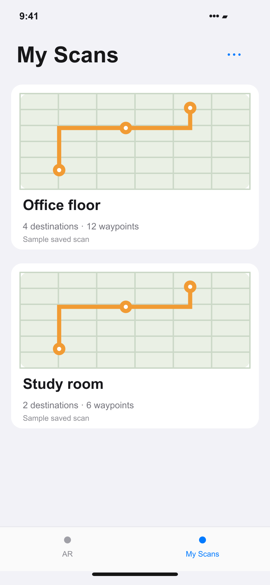
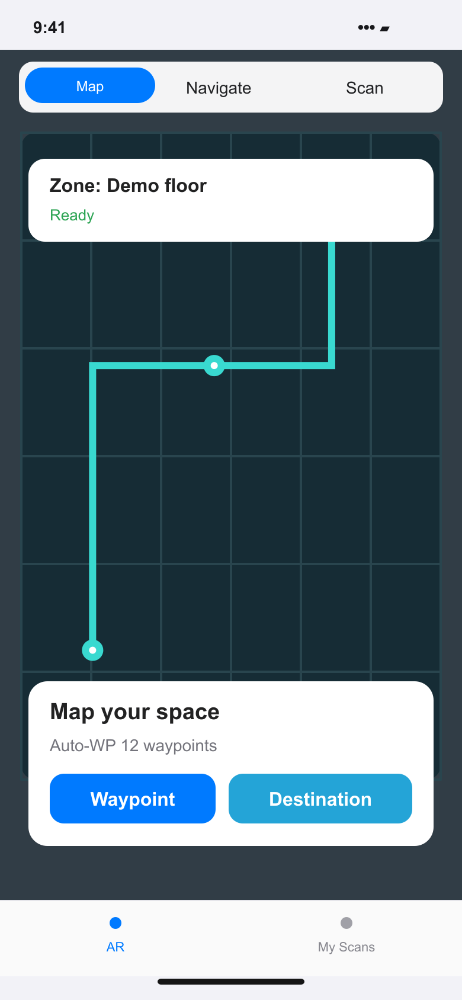

# Portfolio screens

Prepared for the Davin Cuaso portfolio on 6 November 2026.

These are source-based interface recreations with fictional sample data. They are not screenshots from a running native app or backend. Camera scenes and ingredient illustrations are schematic; measurements, saved places, and study statistics are sample content.

The SVG files are editable masters; PNG files are opaque exports.

## Saved scans

Source: [IndoorNav/ScansTabView.swift](https://github.com/davincuaso/IndoorNav/blob/523795f6ccaa50fea8476f9289afdef5e93e65d2/IndoorNav/ScansTabView.swift), [IndoorNav/MainTabView.swift](https://github.com/davincuaso/IndoorNav/blob/523795f6ccaa50fea8476f9289afdef5e93e65d2/IndoorNav/MainTabView.swift).

## AR mapping controls

Source: [IndoorNav/MainTabView.swift](https://github.com/davincuaso/IndoorNav/blob/523795f6ccaa50fea8476f9289afdef5e93e65d2/IndoorNav/MainTabView.swift), [IndoorNav/DesignSystem.swift](https://github.com/davincuaso/IndoorNav/blob/523795f6ccaa50fea8476f9289afdef5e93e65d2/IndoorNav/DesignSystem.swift).

